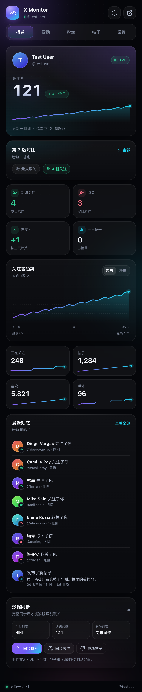
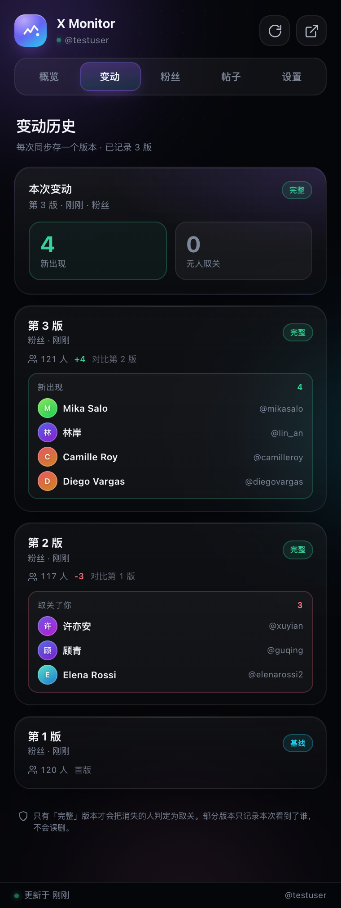
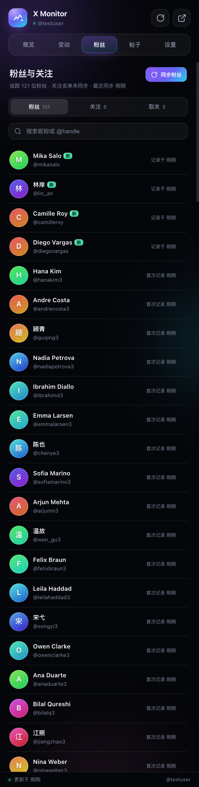
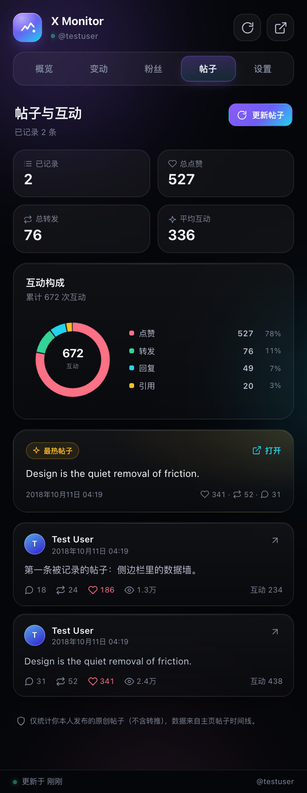
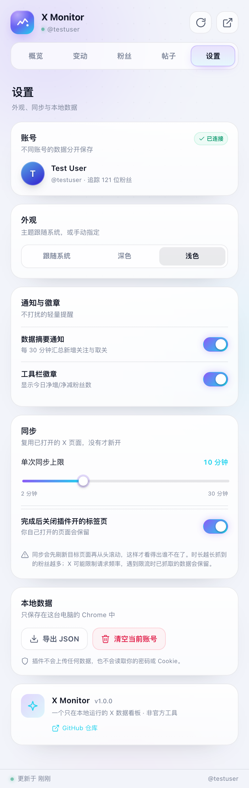
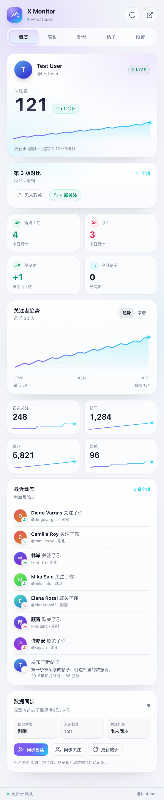

# X Monitor

在 Chrome 侧边栏里查看你的 X（Twitter）账号数据：粉丝增长、取关、帖子互动、历史趋势。
无需 API Key，无需开发者账号，所有数据只保存在你自己的浏览器里。



## 功能

- **今日一览** — 新增关注、取关、净变化、今日发帖数，配上 30 天粉丝趋势曲线。
- **变动历史** — 每次同步存一个版本，自动和上一版对比，直接列出「谁取关了你」「你取关了谁」。
- **粉丝 / 关注名单** — 可搜索、可筛选，标出最近新关注你的人。
- **帖子数据** — 每条帖子的点赞、转发、回复、引用与阅读量，附互动构成环形图与「最热帖子」。
- **多账号** — 自动识别当前登录账号，不同账号的数据分开保存。
- **深色 / 浅色主题** — 默认跟随系统，也可手动切换。
- **工具栏徽章** — 直接显示今日净增 / 净减粉丝数。
- **摘要通知** — 每 30 分钟汇总一次新增关注与取关（可关闭）。

| 变动 | 粉丝 | 帖子 | 设置 |
| --- | --- | --- | --- |
|  |  |  |  |

浅色主题：



## 安装

1. 下载或克隆本仓库：
   ```bash
   git clone https://github.com/super-juejue/X-Monitor.git
   ```
2. 打开 Chrome，访问 `chrome://extensions`。
3. 打开右上角的 **开发者模式**。
4. 点击 **加载已解压的扩展程序**，选择仓库根目录（包含 `manifest.json` 的那一层）。
5. 在 Chrome 中登录 [x.com](https://x.com)，然后点击工具栏上的 X Monitor 图标打开侧边栏。

要求 Chrome 116 或更高版本（侧边栏 API 与 `setPanelBehavior` 的最低版本）。

## 使用

打开侧边栏后，插件会自动识别当前登录的 X 账号，并在你正常浏览 X 的过程中静默记录数据。

想看到完整的取关检测，需要先做一次**完整同步**：

1. 点击侧边栏右上角的同步按钮。
2. 选择「粉丝列表」或「关注列表」。
3. 插件会**复用你已经打开的 x.com 标签页**（没有才新开一个），刷新后自动滚到底部抓取。
   抓完只关闭它自己新开的标签页，你自己的标签页会留着。

每次同步都会存成一个**版本**并和上一版对比：

| 版本 | 含义 |
| --- | --- |
| 基线 | 第一次完整同步，只记下当前名单，不判定新增 / 取关 |
| 完整 | 正常滚到底且人数没有异常缩水，缺席的人会被判定为取关 |
| 部分 | 被限流、中断或人数明显偏少，只记录本次看到谁，不下结论 |

打开侧边栏的「变动」页，可以看到最新版对比上一版的数字、每个人的名字，以及历史版本时间线。

> 同步时请让 X 标签页保持在前台。X 只在页面可见时才继续加载列表，后台标签页会被浏览器节流。

### 为什么「取关」要看版本对比

X 没有提供「谁取关了你」的接口，能拿到的只有一份当下的名单。所以插件每次同步都把名单
存成一个版本，再和上一版逐人比对：

- 上一版有、这一版没有的人 → **取关了你**（这是从粉丝列表比出来的）
- 这一版有、上一版没有的人 → **新关注**
- 关注列表同理，用来回答**你取关了谁**

只有「完整」版本才会下结论；限流、中断、人数异常缩水时只记录看到谁，
避免把一次没抓全的扫描误报成大规模取关。

> 同步会先刷新目标页面再从头滚一遍。这一步不能省：页面上已经渲染的旧行会让人
> 看起来还在名单里，真实取关就被掩盖了。

## 工作原理

```
页面主世界 (src/page-hook.js)
        │  拦截 fetch / XHR 的 /i/api/graphql 响应
        ▼
隔离世界内容脚本 (src/content.js)
        │  CAPTURE / SELF_HINT 消息
        ▼
Service Worker (src/background.js)  ← 唯一的状态写入者
        │  chrome.storage.local
        ▼
侧边栏 (src/sidepanel)  ← 只读渲染
```

- **不额外发请求**：插件只旁路读取你已经登录的浏览器本来就会收到的 GraphQL 响应，
  不会自己调用 X 的接口，也不需要 bearer token。
- **按操作名匹配**：X 会频繁更换 query id，所以解析全部依据 `UserByScreenName`、
  `Followers`、`Following`、`UserTweets` 这类操作名，而不是 id。
- **取关判定有保护**：一次同步只有在「正常滚到底」且「抓到的名单没有异常缩水」时，
  才会把缺席的人标记为取关。中断、限流、超时都会保留已抓数据但跳过取关判断，
  并把这些版本标成「部分」。
- **版本快照**：每次粉丝 / 关注同步都会往本地追加一个版本（最多保留 40 版，
  每版最多 200 人明细）。「变动」页就是把版本按时间排开做差异对比。

## 数据与隐私

- 所有数据保存在 `chrome.storage.local`，不会上传到任何服务器。
- 不读取密码、Cookie 或登录凭据。
- 只申请了 `x.com` 与 `twitter.com` 的主机权限。
- 设置页可以随时导出 JSON 备份，或清空当前账号的全部数据。

权限说明：

| 权限 | 用途 |
| --- | --- |
| `storage` / `unlimitedStorage` | 保存粉丝名单、帖子和历史快照 |
| `sidePanel` | 显示侧边栏界面 |
| `tabs` | 复用 / 打开同步用的 X 标签页 |
| `alarms` | 定时刷新徽章、发送摘要通知 |
| `notifications` | 摘要通知 |
| `host_permissions` | 注入内容脚本，读取 X 页面上的数据 |

## 已知限制

- **X 的请求频率限制**：粉丝 / 关注列表接口大约 15 分钟只允许 50 次请求，每次返回约 20 条。
  也就是说一次同步最多抓 1000 位左右，超过这个数量会在中途被限流。被限流时已抓到的数据会保留，
  等 15 分钟再同步即可继续补齐；名单抓全之前插件不会误判取关。
- 首次完整同步之前，插件无法判断谁取关了你。
- 同步期间请让 X 标签页保持在前台。浏览器会节流后台标签页，抓取会变慢且可能提前结束。
- **同步会刷新目标页面**：正在该页面输入的内容会丢失。这是为了拿到干净的名单，见上文。
- 版本历史每个账号保留最近 40 版，超出的旧版本会自动丢弃。
- 数据来自 X 的网页端接口，X 改版后解析规则可能需要更新。

## 开发

```bash
npm test          # 解析器 + Service Worker 集成测试（Node 20+）
python3 scripts/make-icons.py   # 重新生成图标
```

项目没有构建步骤，也没有运行时依赖：改完源码后，在 `chrome://extensions` 里点一下
刷新即可。

```
manifest.json
icons/              # 扩展图标（由 scripts/make-icons.py 生成）
src/
  page-hook.js      # MAIN world 的 GraphQL 旁路拦截
  content.js        # 桥接、账号识别、同步自动滚动
  background.js     # Service Worker：状态、版本快照、差异计算、同步生命周期
  lib/              # 解析、聚合、时间与常量（纯函数，可单独测试）
  sidepanel/        # 侧边栏 UI（原生 ES Modules，无框架）
tests/              # node:test 测试
docs/               # 截图
```

## 说明

非官方工具，与 X Corp. 无关。本项目只读取你自己账号可见的数据，请遵守 X 的服务条款。

## License

[Apache-2.0](LICENSE)
