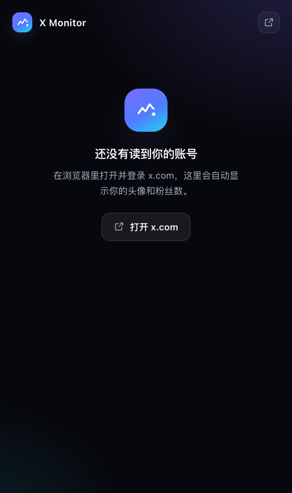

# X Monitor

Chrome 侧边栏里的一张卡：你的 X 头像、昵称、@handle，和粉丝 / 关注 / 帖子数。
只读、不联网请求、数据只留在这台电脑上。


## 它做什么

打开侧边栏，它显示当前登录的 X 账号：

- 头像、昵称、@handle、蓝标
- 粉丝数、关注数、帖子数
- 这些数字最后一次更新的时间

就这些，没有别的页面和按钮。

| 浅色主题 | 还没读到账号 |
| --- | --- |
|  |  |

## 安装

1. 克隆仓库：

   ```bash
   git clone https://github.com/super-juejue/X-Monitor.git
   ```

2. 打开 Chrome → `chrome://extensions`，打开右上角 **开发者模式**。
3. 点 **加载已解压的扩展程序**，选择仓库根目录（含 `manifest.json` 那一层）。
4. 在 Chrome 里登录 [x.com](https://x.com)，点工具栏图标打开侧边栏。

需要 Chrome 116 或更高版本（侧边栏 API 的最低版本）。

## 怎么拿到数据

插件不请求任何接口，也没有 API Key 或 token。它只是旁路读取你的浏览器登录 X 后
本来就会收到的响应：

```
X 页面发出 /i/api/graphql 请求
        │
        ▼
src/page-hook.js（页面主世界）
        │  只挑 Viewer 与 UserByScreenName
        ▼
src/content.js（隔离世界）
        │  转交，并从页面顶栏读出 @handle
        ▼
src/background.js（Service Worker，唯一写入者）
        │  chrome.storage.local
        ▼
侧边栏（只读渲染）
```

- **按操作名匹配**：X 经常更换 query id，所以解析只认 `Viewer`、
  `UserByScreenName` 这类操作名。
- **不会把别人当成你**：只有 `Viewer` 响应能确定登录账号；别人的主页不会覆盖你的
  信息，切换账号时会清掉上一个账号的数字。
- **数据只存在本地**：全部在 `chrome.storage.local`，设置页之外没有任何上报。

## 权限

| 权限 | 用途 |
| --- | --- |
| `storage` | 保存账号信息与计数 |
| `sidePanel` | 显示侧边栏 |
| `host_permissions` | 在 x.com 上运行内容脚本，读取页面已经收到的数据 |

## 开发

```bash
npm test                       # 解析器 + Service Worker 测试（Node 20+）
python3 scripts/make-icons.py  # 重新生成图标
```

没有构建步骤，也没有运行时依赖。改完源码后在 `chrome://extensions` 点刷新即可。

```
manifest.json
icons/              # 扩展图标
src/
  page-hook.js      # MAIN world，旁路捕获 GraphQL 响应
  content.js        # 桥接 + 读取当前账号
  background.js     # Service Worker：状态与消息
  lib/              # 解析与格式化（纯函数，可单独测试）
  sidepanel/        # 侧边栏（原生 ES Modules，无框架）
tests/              # node:test
docs/               # 截图
```

## 说明

非官方工具，与 X Corp. 无关。只读取你自己账号可见的数据，请遵守 X 的服务条款。

## License

[Apache-2.0](LICENSE)
