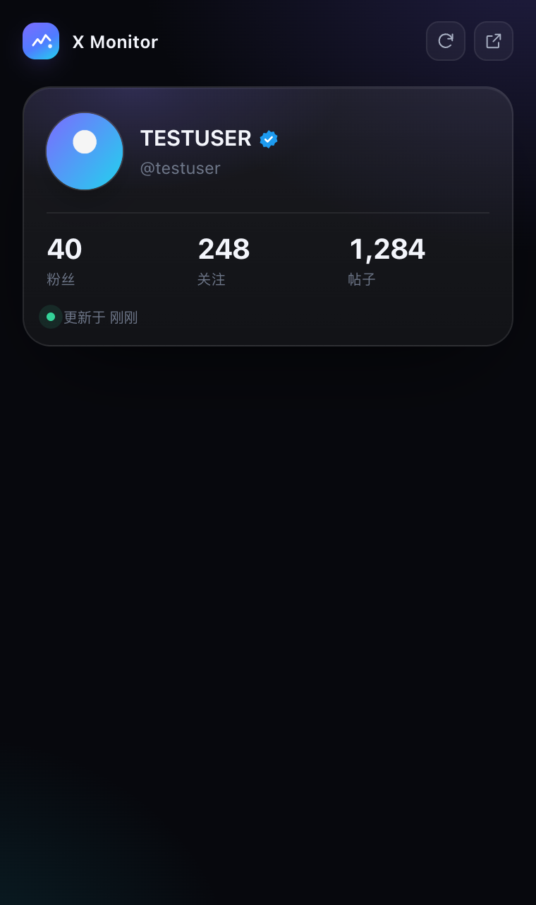

# X Monitor

One card in a Chrome side panel: your X avatar, name, @handle, and your follower,
following and post counts. It never calls an API of its own, and the data never
leaves this machine.


## What it does

Open the side panel and it shows the X account you are signed in as:

- avatar, name, @handle, and the blue check
- follower, following and post counts
- when those numbers were last updated
- a **refresh** button in the top right that asks X for new numbers

That is the whole extension. There are no other pages.

| Refreshing | Numbers not read yet |
| --- | --- |
|  |  |

Light theme:


## Install

1. Clone the repository:

   ```bash
   git clone https://github.com/super-juejue/X-Monitor.git
   ```

2. Open Chrome and go to `chrome://extensions`, then turn on **Developer mode**
   in the top right.
3. Click **Load unpacked** and choose the repository root, the folder that
   contains `manifest.json`.
4. Sign in to [x.com](https://x.com) in Chrome, then click the toolbar icon to
   open the side panel.

Requires Chrome 116 or newer, the first version with the side panel API.

## Where the numbers come from

The extension never calls an API itself. There is no API key and no token. The
numbers come from three places, and any one of them is enough:

1. **X's own `Viewer` response.** This is what tells the extension who is
   signed in, and it usually carries the follower, following and post counts too.
2. **Your own profile page.** When you open `/your-handle`, the extension reads
   "N Followers / N Following / N posts" from the header. This one matters: X
   caches its API responses, so a second visit can paint the page with **no
   request at all**, and an approach that only listens to the network would wait
   forever.
3. **The owner of a followers or following list.** Those responses describe the
   account whose list it is, counts included.

```
X page sends /i/api/graphql            your own profile DOM
        │                                      │
        ▼                                      ▼
src/page-hook.js (main world)          src/content.js
        │  keeps only Viewer* / UserByScreenName* / Followers / Following
        │  for a list it relays the owner, not the whole timeline
        ▼                                      │
src/content.js (isolated world) ───────────────┘
        │  CAPTURE / SELF_HINT / PROFILE_HINT
        ▼
src/background.js (service worker, the only writer)
        │  chrome.storage.local
        ▼
side panel (renders and nothing else)
```

- **Matched by operation name.** X rotates its query ids constantly, so only
  names like `Viewer` and `UserByScreenName` are trusted.
- **Nobody else becomes you.** Only a `Viewer` response can prove who is signed
  in. Another person's profile or follower list can never overwrite your
  details, and switching accounts drops the previous account's numbers.
- **Read-only.** The DOM is read, never injected into, clicked or scrolled.
- **Local only.** Everything lives in `chrome.storage.local`. Nothing is
  reported anywhere.

### The refresh button

The numbers can only come from X, so refreshing is not a second read of the
local cache. It **makes X load your profile again** and catches the numbers that
arrive:

- You already have `/your-handle` open: that tab is reloaded, which is what you
  would expect from a page that is already your profile.
- You have some other x.com page open: it is **left alone**. A hidden tab loads
  your profile in the background, and closes itself as soon as the numbers are
  in, so the page you are reading is never thrown away.
- If no numbers arrive within 15 seconds it gives up and says so, and the hidden
  tab is closed either way.

The button appears once the account is known, spins and disables itself while a
refresh is running, and reports the outcome on a line under the card.

One detail worth knowing: a refresh only counts numbers from a page that
**appeared after it started**. The page being replaced keeps a few timers alive,
and its last report repeats the numbers already on screen. Accepting that report
makes the button report success while nothing has changed.


### If you only see the @handle and no numbers

Click **refresh** in the top right. It loads your profile once more and the
numbers follow. You can also open your own profile yourself; the
"open x.com" button reuses a tab you already have instead of opening another.

## Languages

The panel follows Chrome's language: English and Simplified Chinese are
included, and anything else falls back to English.

| English | 简体中文 |
| --- | --- |
|  |  |

Wording and its translations live in `_locales/`, the standard Chrome message
bundles, so adding a language means adding one folder. Numbers and dates are
formatted by `Intl` with the language Chrome resolved, not with a fixed locale.
`npm test` checks that every bundle defines the same keys and that no copy is
hard-coded in the source.

## Permissions

| Permission | Why |
| --- | --- |
| `storage` | Keep the account details and counts |
| `sidePanel` | Show the side panel |
| `host_permissions` | Run the content scripts on x.com and read data the page already received |

There is no `tabs` permission. A refresh only needs to know whether an x.com tab
is open, and host permissions already make that tab's url readable, so there is
no reason to ask for more.

## Development

```bash
npm test                       # parsers and service worker (Node 20+)
python3 scripts/make-icons.py  # regenerate the icons
```

No build step and no runtime dependencies. After editing the source, hit reload
on `chrome://extensions`.

```
manifest.json       # default_locale, plus __MSG_appDesc__ for the description
_locales/           # en and zh_CN message bundles
icons/              # extension icons
src/
  page-hook.js      # main world, observes GraphQL responses in passing
  content.js        # bridge, plus the @handle and the profile counts
  background.js     # service worker: state, and how three sources merge
  lib/              # parsing, formatting and translations (pure, tested alone)
  sidepanel/        # the panel (native ES modules, no framework)
tests/              # node:test
docs/               # screenshots
```

## Notes

An unofficial tool, not affiliated with X Corp. It only reads data that is
already visible to your own account. Respect X's terms of service.

## License

[Apache-2.0](LICENSE)
