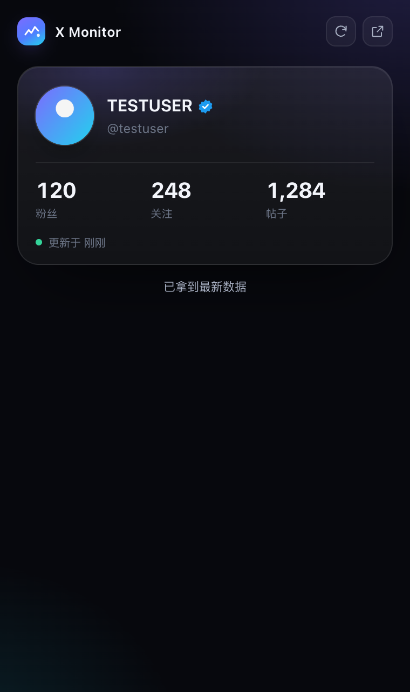

# X Monitor

Chrome 侧边栏里的一张卡：你的 X 头像、昵称、@handle，和粉丝 / 关注 / 帖子数。
自己不调用任何接口，数据只留在这台电脑上。


## 它做什么

打开侧边栏，它显示当前登录的 X 账号：

- 头像、昵称、@handle、蓝标
- 粉丝数、关注数、帖子数
- 这些数字最后一次更新的时间
- 右上角的 **刷新** 按钮，重新去 X 取一次数据

就这些，没有别的页面。

| 刷新中 | 还没读到数字 |
| --- | --- |
|  |  |

浅色主题：


## 安装

1. 克隆仓库：

   ```bash
   git clone https://github.com/super-juejue/X-Monitor.git
   ```

2. 打开 Chrome → `chrome://extensions`，打开右上角 **开发者模式**。
3. 点 **加载已解压的扩展程序**，选择仓库根目录（含 `manifest.json` 那一层）。
4. 在 Chrome 里登录 [x.com](https://x.com)，点工具栏图标打开侧边栏。

需要 Chrome 116 或更高版本（侧边栏 API 的最低版本）。

## 怎么拿到数据

插件自己不调用任何接口，也没有 API Key 或 token。数字来自三个地方，任意一个成功就够了：

1. **X 自己的 `Viewer` 响应** — 登录账号由它确定，通常也带着粉丝 / 关注 / 帖子数。
2. **你自己的主页** — 打开 `/你的用户名` 时，插件从页面头部的
   「N Followers / N Following / N posts」里读。这一步很重要：X 会缓存接口响应，
   再次访问主页时可能**一个请求都不发**，只靠拦截就永远等不到数字。
3. **粉丝 / 关注列表的 owner** — 打开粉丝列表时，响应里的列表主人同样带着计数。

```
X 页面发出 /i/api/graphql 请求          你自己的主页 DOM
        │                                      │
        ▼                                      ▼
src/page-hook.js（主世界）              src/content.js
        │  只挑 Viewer* / UserByScreenName* / Followers / Following
        │  列表只转发 owner，不搬整份名单
        ▼                                      │
src/content.js（隔离世界） ────────────────────┘
        │  CAPTURE / SELF_HINT / PROFILE_HINT
        ▼
src/background.js（Service Worker，唯一写入者）
        │  chrome.storage.local
        ▼
侧边栏（只读渲染）
```

- **按操作名匹配**：X 经常更换 query id，所以只认 `Viewer`、`UserByScreenName`
  这类操作名。
- **不会把别人当成你**：只有 `Viewer` 能确定登录账号。别人的主页、别人的粉丝列表
  都不会覆盖你的信息；切换账号时会清掉上一个账号的数字。
- **只读，不改页面**：DOM 只读取，不注入、不点击、不滚动。
- **数据只存在本地**：全部在 `chrome.storage.local`，没有任何上报。

### 刷新按钮

数字只能从 X 自己那里来，所以「刷新」不是重新读一遍本地缓存，而是**让 X 重新加载一次主页**，
再把新数字接住：

- 你已经开着 `/你的用户名` → 直接刷新那个标签页（它本来就是主页，刷新是预期的）。
- 你开着的是别的 x.com 页面 → **不动它**，在后台开一个隐藏标签页加载主页，拿到数字后立刻关掉，
  你正在读的页面不会被重置。
- 15 秒内没等到数字就停下并回报失败，隐藏标签页照样会关掉。

按钮在已知账号后出现，刷新期间旋转并禁用，结束时在卡片下方给出一句结果。

一个细节：刷新只认**刷新开始之后**才出现的那份页面报上来的数字。被替换掉的旧页面
还留着几个定时器，它最后那次上报带的是屏幕上已有的旧数字，收下它就会「成功但什么都没变」。



### 如果只看到 @handle、没有数字

点右上角的 **刷新**。它会让 X 重新加载一次你的主页，数字随之补上。也可以直接打开
一次自己的主页（面板上的「打开 x.com」按钮会复用已打开的标签页）。

## 权限

| 权限 | 用途 |
| --- | --- |
| `storage` | 保存账号信息与计数 |
| `sidePanel` | 显示侧边栏 |
| `host_permissions` | 在 x.com 上运行内容脚本，读取页面已经收到的数据 |

没有申请 `tabs` 权限。刷新只需要知道「有没有开着 x.com 的标签页」，而主机权限
已经让 x.com 标签页的 url 可读，所以不需要再多要一个权限。

## 开发

```bash
npm test                       # 解析器 + Service Worker 测试（Node 20+）
python3 scripts/make-icons.py  # 重新生成图标
```

没有构建步骤，也没有运行时依赖。改完源码后在 `chrome://extensions` 点刷新即可。

```
manifest.json
icons/              # 扩展图标
src/
  page-hook.js      # MAIN world，旁路捕获 GraphQL 响应
  content.js        # 桥接 + 读取 @handle 与主页计数
  background.js     # Service Worker：状态与三条数据来源的合并规则
  lib/              # 解析与格式化（纯函数，可单独测试）
  sidepanel/        # 侧边栏（原生 ES Modules，无框架）
tests/              # node:test
docs/               # 截图
```

## 说明

非官方工具，与 X Corp. 无关。只读取你自己账号可见的数据，请遵守 X 的服务条款。

## License

[Apache-2.0](LICENSE)
