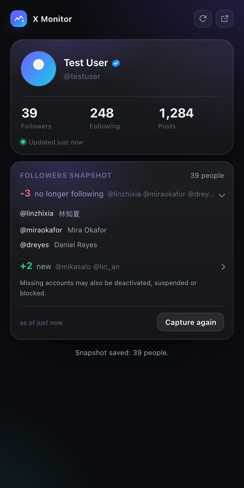
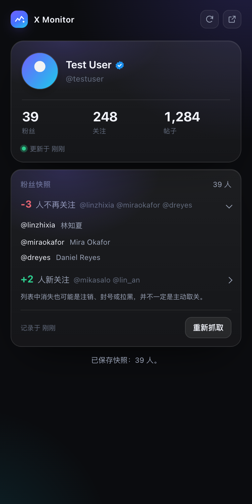

# X Monitor

A compact Chrome side panel for your X account and follower changes. Save a
local follower snapshot, then compare the next capture to see who disappeared
and who is new. No API key, no server, no uploads.



## What it does

Open the side panel and it shows the X account you are signed in as:

- avatar, name, @handle, and the blue check
- follower, following and post counts
- when those numbers were last updated
- a **refresh** button in the top right that asks X for new numbers
- a **Capture followers** button that saves a local baseline
- changes since the previous complete capture, with expandable account links

There are no other pages. Light and dark themes follow the system.

## Install

1. Clone the repository:

   ```bash
   git clone https://github.com/super-juejue/X-Monitor.git
   ```

2. Open Chrome and go to `chrome://extensions`, then turn on **Developer mode**
   in the top right.
3. Click **Load unpacked** and choose the repository root, the folder that
   contains `manifest.json`.
4. Sign in to [x.com](https://x.com) in Chrome, then click the toolbar icon to
   open the side panel.

Requires Chrome 116 or newer, the first version with the side panel API.

## Where the numbers come from

The extension never calls an API itself. There is no API key and no token. The
numbers come from three places, and any one of them is enough:

1. **X's own `Viewer` response.** This is what tells the extension who is
   signed in, and it usually carries the follower, following and post counts too.
2. **Your own profile page.** When you open `/your-handle`, the extension reads
   "N Followers / N Following / N posts" from the header. This one matters: X
   caches its API responses, so a second visit can paint the page with **no
   request at all**, and an approach that only listens to the network would wait
   forever.
3. **The owner of a followers or following list.** Those responses describe the
   account whose list it is, counts included.

```
X page sends /i/api/graphql            your own profile DOM
        │                                      │
        ▼                                      ▼
src/page-hook.js (main world)          src/content.js
        │  keeps only Viewer* / UserByScreenName* / Followers / Following
        │  for Followers it also relays identities and pagination cursors
        ▼                                      │
src/content.js (isolated world) ───────────────┘
        │  CAPTURE / SELF_HINT / PROFILE_HINT / FOLLOWERS_RESULT
        ▼
src/background.js (service worker, the only writer)
        │  chrome.storage.local
        ▼
side panel (renders and nothing else)
```

- **Matched by operation name.** X rotates its query ids constantly, so only
  names like `Viewer` and `UserByScreenName` are trusted.
- **Nobody else becomes you.** Only a `Viewer` response can prove who is signed
  in. Another person's profile or follower list can never overwrite your
  details, and switching accounts drops the previous account's numbers.
- **Read-only.** Never posts, likes, follows or unfollows. A requested capture
  scrolls a temporary followers tab, not the page you are reading.
- **Local only.** Everything lives in `chrome.storage.local`. Nothing is
  reported anywhere.

### The refresh button

The numbers can only come from X, so refreshing is not a second read of the
local cache. It **makes X load your profile again** and catches the numbers that
arrive:

- You already have `/your-handle` open: that tab is reloaded, which is what you
  would expect from a page that is already your profile.
- You have some other x.com page open: it is **left alone**. A hidden tab loads
  your profile in the background, and closes itself as soon as the numbers are
  in, so the page you are reading is never thrown away.
- If no numbers arrive within 15 seconds it gives up and says so, and the hidden
  tab is closed either way.

The button appears once the account is known, spins and disables itself while a
refresh is running, and reports the outcome on a line under the card.

One detail worth knowing: a refresh only counts numbers from a page that
**appeared after it started**. The page being replaced keeps a few timers alive,
and its last report repeats the numbers already on screen. Accepting that report
makes the button report success while nothing has changed.

### If you only see the @handle and no numbers

Click **refresh** in the top right. It loads your profile once more and the
numbers follow. You can also open your own profile yourself; the
"open x.com" button reuses a tab you already have instead of opening another.

## Follower snapshots

1. Click **Capture followers**. A new background tab loads
   `/your-handle/followers` and scrolls while X loads the list.
2. A complete first capture becomes the baseline. The tab closes automatically.
3. Click **Capture again** later. The panel compares it with the last complete
   snapshot and shows accounts no longer in the list and new followers.
4. Expand a change row to see the accounts and open their profiles.

Every capture uses a fresh document, even if a followers tab is already open.
Existing tabs are not reloaded, scrolled or closed. The capture button shows how
many people have been read, and a reopened panel can see a capture in progress.
This is on demand, not a scheduled monitor.

### What gets saved

The **latest two complete snapshots** are kept in `chrome.storage.local`, plus
their latest comparison. This is a rolling baseline, not an unlimited history.
Each entry contains only the account ID, @handle and display name. Stable account
IDs keep a rename from looking like an unfollow followed by a new follow.

The panel shows the current account's snapshots only. A capture for another
account starts a new baseline. Nothing syncs to a server, and uninstalling the
extension removes its local data.

### Incomplete lists are not compared

A list is accepted only when its pages link back to the first cursor, X returns
a recognizable end, and the unique account count **exactly matches a fresh
counter observed during the capture**. No percentage tolerance. A verified
empty list with a counter of zero is a valid snapshot too.

If X stalls, rate limits the page, changes its response format, omits the counter
or returns fewer accounts than its counter reports, the capture is refused.
Both previous snapshots and their comparison stay untouched. Storage failures
also leave the previous baseline intact.

Limits: **30,000 followers**, **400 pages**, a **45-second reading budget**
(60 seconds overall), and an 8 MiB snapshot-storage budget. A stalled list stops
earlier. The panel displays up to 200 account names on each side of a comparison,
with the full change count and a notice if names were capped.

“No longer following” means an account disappeared between two captures, not
proof of an intentional unfollow. Deactivation, suspension and blocking can
produce the same result. The exact time or reason cannot be recovered.

## Languages

The panel follows Chrome's language: English and Simplified Chinese are
included, and anything else falls back to English.

| English | 简体中文 |
| --- | --- |
|  |  |

Wording and its translations live in `_locales/`, the standard Chrome message
bundles, so adding a language means adding one folder. Numbers and dates are
formatted by `Intl` with the language Chrome resolved, not with a fixed locale.
`npm test` checks that every bundle defines the same keys and that no copy is
hard-coded in the source.

## Permissions

| Permission | Why |
| --- | --- |
| `storage` | Keep account details, counts and the latest two follower snapshots |
| `sidePanel` | Show the side panel |
| `host_permissions` | Run the content scripts on x.com and read data the page already received |

There is no `tabs` permission. Creating, messaging and closing a temporary tab
does not require it. Host permissions already make x.com tab URLs readable for
the refresh and open-x.com actions.

## Development

```bash
npm test                       # hook, content script, snapshots, worker and i18n (Node 20+)
python3 scripts/make-icons.py  # regenerate the icons
```

No build step and no runtime dependencies. After editing the source, hit reload
on `chrome://extensions`.

```
manifest.json       # default_locale, plus __MSG_appDesc__ for the description
_locales/           # en and zh_CN message bundles
icons/              # extension icons
src/
  page-hook.js      # main world, observes GraphQL responses in passing
  content.js        # bridge, account hints and follower-list scrolling
  background.js     # service worker: account state, refresh and snapshot storage
  lib/              # parsing, formatting and translations (pure, tested alone)
  sidepanel/        # the panel (native ES modules, no framework)
tests/              # node:test
docs/               # screenshots
```

Browser checks use a local simulated X site with the actual extension in Chrome
for Testing: pagination, changed followers, stalled captures, tab cleanup, reload
persistence and zero followers. Screenshots use fictional test accounts. This
environment could not validate the feature against the live X site.

## Notes

An unofficial tool, not affiliated with X Corp. It only reads data that is
already visible to your own account. Respect X's terms of service.

## License

[Apache-2.0](LICENSE)
